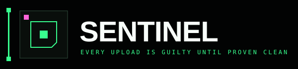
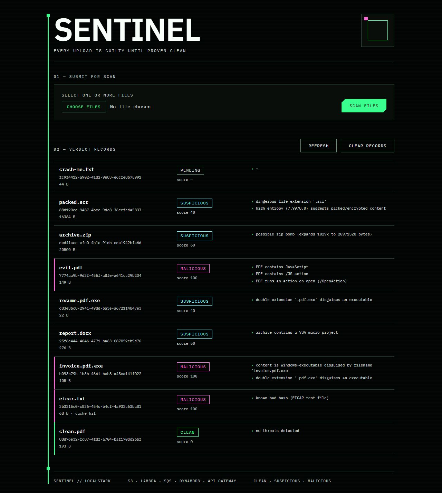
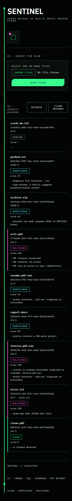
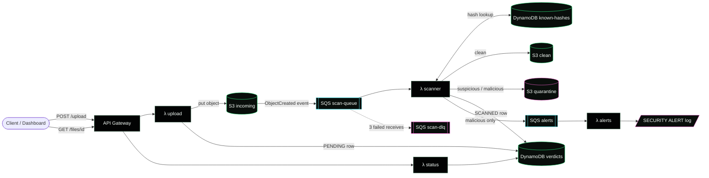
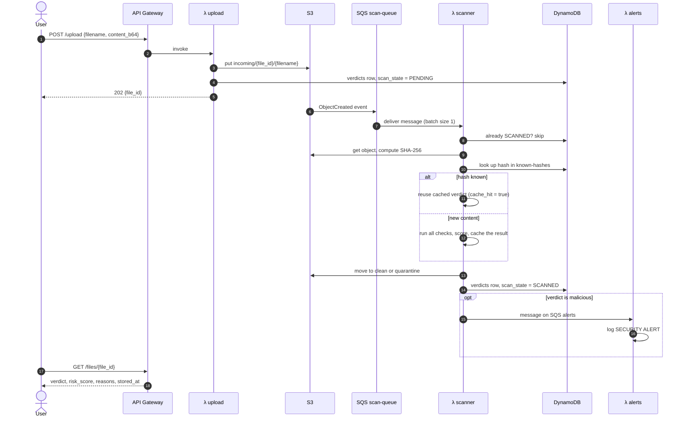
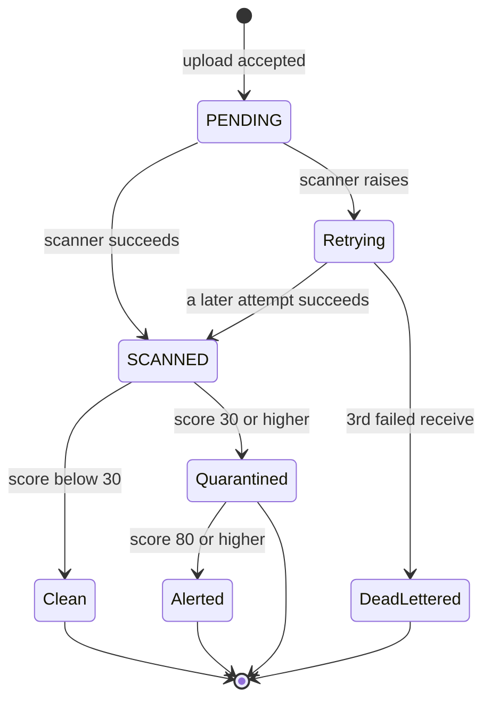
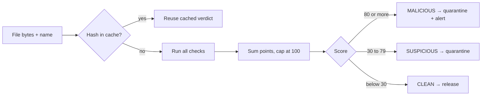
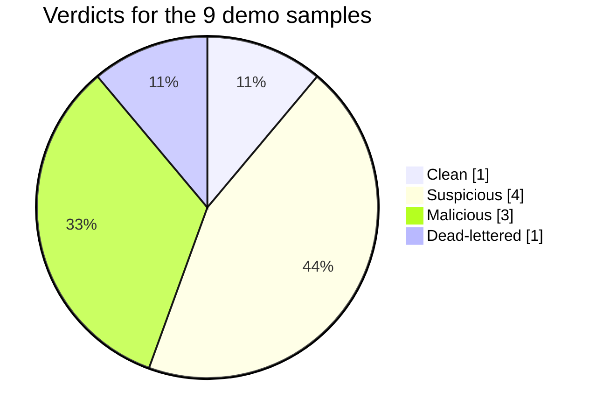

<p align="center">
  
</p>

<p align="center">
  <b>A serverless file-scanning pipeline that runs entirely on your laptop.</b><br/>
  Uploads are scanned, scored, and either released or quarantined. Nothing is shared until it passes.
</p>

<p align="center">
  
  
  
  
</p>

<p align="center">
  
  &nbsp;&nbsp;
  
  &nbsp;&nbsp;
  
  <br/>
  <sub><b>AWS cloud services, running on your laptop through LocalStack</b></sub>
</p>

## Built with

<table align="center">
  <tr>
    <td align="center" width="110"><br/><b>AWS</b><br/><sub>Cloud platform</sub></td>
    <td align="center" width="110"><br/><b>AWS Cloud</b><br/><sub>Emulated locally</sub></td>
    <td align="center" width="110"><br/><b>Amazon S3</b><br/><sub>3 buckets</sub></td>
    <td align="center" width="110"><br/><b>AWS Lambda</b><br/><sub>4 functions</sub></td>
    <td align="center" width="110"><br/><b>DynamoDB</b><br/><sub>2 tables</sub></td>
    <td align="center" width="110"><br/><b>API Gateway</b><br/><sub>REST API</sub></td>
  </tr>
  <tr>
    <td align="center" width="110"><br/><b>Amazon SQS</b><br/><sub>3 queues + DLQ</sub></td>
    <td align="center" width="110"><br/><b>LocalStack</b><br/><sub>Local AWS</sub></td>
    <td align="center" width="110"><br/><b>Terraform</b><br/><sub>IaC</sub></td>
    <td align="center" width="110"><br/><b>Docker</b><br/><sub>Compose</sub></td>
    <td align="center" width="110"><br/><b>Python 3.11</b><br/><sub>Lambda runtime</sub></td>
    <td align="center" width="110"></td>
  </tr>
</table>

---

Built for **Track 2: "Cloud in a Box" Local Serverless Hack (LocalStack)**. The whole AWS backend
(S3, Lambda, DynamoDB, API Gateway, SQS) is defined in Terraform and runs inside a LocalStack
Docker container. No AWS account and no credit card are needed.

## Contents

- [Built with](#built-with)
- [Screenshots](#screenshots)
- [What works](#what-works)
- [Architecture](#architecture)
- [Workflow](#workflow)
- [Quick start](#quick-start)
- [Using the dashboard](#using-the-dashboard)
- [API](#api)
- [What the scanner checks](#what-the-scanner-checks)
- [Reliability features](#reliability-features)
- [Demo results](#demo-results)
- [Tests](#tests)
- [Project layout](#project-layout)
- [Troubleshooting](#troubleshooting)

## Screenshots

The dashboard after running `make demo`. Every row is a real verdict read from DynamoDB.

<p align="center">
  
</p>

<details>
<summary><b>Mobile layout (390px)</b></summary>
<p align="center">
  
</p>
</details>

`crash-me.txt` stays `PENDING` on purpose. The scanner fails on it every time, so after 3 attempts
SQS moves the message to the dead-letter queue instead of producing a verdict.

## What works

Each item below was run against a live LocalStack stack.

| Feature | Status | How it was checked |
|---|:---:|---|
| LocalStack starts healthy with one command | ✅ | `docker compose up -d --wait` |
| Terraform creates every resource | ✅ | 3 buckets, 3 queues, 2 tables, 4 Lambdas, REST API |
| Upload API (`POST /upload`) | ✅ | Returns `202` with a `file_id` |
| Status API (`GET /files/{id}`) | ✅ | Returns verdict, score, reasons, storage location |
| S3 event → SQS → scanner Lambda | ✅ | Files move from `PENDING` to `SCANNED` |
| Clean files released, flagged files quarantined | ✅ | `stored_at` points to `sentinel-clean` or `sentinel-quarantine` |
| Detection matches expected verdicts | ✅ | 8 of 8 samples pass in `make demo` |
| Explainable verdicts | ✅ | Every verdict lists its reasons |
| Hash cache / idempotency | ✅ | EICAR resolves from the seeded hash, `cache_hit = true` |
| Retries + dead-letter queue | ✅ | `crash-me.txt` ends in `sentinel-scan-dlq` (depth 1) |
| Security alert pipeline | ✅ | `SECURITY ALERT` lines in the alerts Lambda log |
| Dashboard: multi-file upload | ✅ | Several files per scan, summary of clean / flagged |
| Dashboard: clear records | ✅ | Empties the verdicts table and the three buckets |
| Unit tests | ✅ | 27 passing, no Docker needed |

Not done yet: a test from a fresh clone on a second machine, a CI workflow, and the ClamAV / YARA stretch goals.

## Architecture



| Resource | Name | Purpose |
|---|---|---|
| S3 | `sentinel-incoming` | Holding area for new uploads |
| S3 | `sentinel-clean` | Files that passed the scan |
| S3 | `sentinel-quarantine` | Suspicious and malicious files, kept for audit |
| SQS | `sentinel-scan-queue` | Buffers S3 events for the scanner |
| SQS | `sentinel-scan-dlq` | Holds scans that failed 3 times |
| SQS | `sentinel-alerts` | Malicious verdicts waiting for the alerts Lambda |
| DynamoDB | `sentinel-verdicts` | One row per upload (`file_id`) |
| DynamoDB | `sentinel-known-hashes` | Verdict cache keyed by SHA-256, seeded with EICAR |
| Lambda | `sentinel-upload`, `-status`, `-scanner`, `-alerts` | Python 3.11 handlers |
| API Gateway | `sentinel-api`, stage `v1` | `POST /upload`, `GET /files/{id}` |

A static version of the diagram is in [`docs/architecture.svg`](docs/architecture.svg).

## Workflow

What happens to one file from upload to verdict:



How a file's state changes:



## Quick start

**Prerequisites:** Docker Desktop (Compose v2), Terraform 1.5 or newer, Python 3.10 or newer.
`make` is optional; Windows users get `make.ps1`. A LocalStack auth token is optional, because the
default community image runs every service Sentinel uses.

**Windows (PowerShell)**

```powershell
git clone https://github.com/nonsense3/Sentinel.git
cd Sentinel
Copy-Item .env.example .env
pip install -r requirements-dev.txt
.\make.ps1 up          # start LocalStack and deploy with Terraform
.\make.ps1 demo        # upload the sample files and print the verdict table
.\make.ps1 dashboard   # open http://localhost:8080
```

**macOS / Linux**

```bash
git clone https://github.com/nonsense3/Sentinel.git
cd Sentinel
cp .env.example .env
pip install -r requirements-dev.txt
make up
make demo
make dashboard
```

**By hand (any OS)**

```bash
docker compose up -d --wait
cd terraform && terraform init && terraform apply -auto-approve && cd ..
python scripts/demo.py
python dashboard/server.py
```

All task runner targets:

| Target | What it does |
|---|---|
| `up` | Start LocalStack and run `terraform apply` |
| `deploy` | Run `terraform init` and `apply` only |
| `demo` | Generate samples, upload them, print PASS / FAIL |
| `dashboard` | Serve the dashboard on port 8080 |
| `test` | Run the unit tests |
| `alerts` | Show `SECURITY ALERT` lines from the alerts Lambda's CloudWatch log |
| `dlq` | Show the dead-letter queue depth (needs `awslocal`) |
| `logs` | Follow the LocalStack log |
| `down` | Stop LocalStack |
| `reset` | Remove containers, volumes, Terraform state, and samples |

## Using the dashboard

```bash
.\make.ps1 dashboard     # or: python dashboard/server.py
```

Open `http://localhost:8080`.

1. **Choose files** and pick one or more files.
2. **Scan files** uploads each one, waits for the verdicts, and prints a summary.
3. Each record shows the filename, `file_id`, size, verdict, score, and the reasons behind it.
4. **Refresh** reloads the list. **Clear records** deletes every verdict row and empties the three
   buckets after a confirmation. The hash cache is kept, so re-uploading a known file still shows `cache hit`.

The dashboard is a small local Python server (`dashboard/server.py`). It serves the page and
forwards calls to the deployed API Gateway, so the browser never deals with CORS. It reads the
current API URL from `terraform output` when it starts.

## API

| Method | Path | Body | Response |
|---|---|---|---|
| `POST` | `/upload` | `{"filename": "a.pdf", "content_b64": "<base64>"}` | `202 {"file_id": "..."}` |
| `GET` | `/files/{id}` | none | `200` with the verdict record, or `404` |

Get the base URL with:

```bash
cd terraform && terraform output -raw api_url
# http://localhost:4566/restapis/<api-id>/v1/_user_request_
```

The base URL on its own returns an error page. Add `/upload` or `/files/{id}` to it.

Example response from `GET /files/{id}`:

```json
{
  "file_id": "eb96eb50-edd0-4693-ab1c-6113e4b68e26",
  "filename": "hello.pdf",
  "scan_state": "SCANNED",
  "verdict": "clean",
  "risk_score": 0,
  "reasons": ["no threats detected"],
  "sha256": "c0c00f3ad184adaa3204435237674f7477397653a2a0a80f34a8d99717cafe79",
  "size_bytes": 25,
  "cache_hit": false,
  "stored_at": "s3://sentinel-clean/eb96eb50-edd0-4693-ab1c-6113e4b68e26/hello.pdf",
  "uploaded_at": "2026-11-03T15:26:57.810793+00:00",
  "scanned_at": "2026-11-03T15:26:58.226317+00:00"
}
```

## What the scanner checks

Every check is a pure Python function in `src/common/scanner_lib/checks.py`, so it can be unit tested without AWS.

| Check | Catches | Points |
|---|---|---|
| Hash lookup | Known-bad files and earlier verdicts for identical content | reuses the stored score |
| Magic bytes vs extension | An executable disguised as a document, e.g. `invoice.pdf.exe` with an `MZ` header | 70 |
| | Content that doesn't match its extension, e.g. a PNG named `.pdf` | 25 |
| Filename tricks | Double extension (`resume.pdf.exe`) | 40 |
| | Right-to-left override character | 40 |
| | Dangerous extension (`.exe`, `.scr`, `.js`, `.ps1`, ...) | 20 |
| Content patterns | EICAR test signature | 100 |
| | PDF `/JavaScript`, `/Launch` | 50 each |
| | PDF `/JS`, `/OpenAction` | 40 each |
| | Encoded PowerShell / download-and-run | 60 / 40 |
| Entropy | Packed or encrypted data (Shannon entropy of 7.5 or more, files over 256 bytes) | 20 |
| ZIP metadata (never extracted) | Zip bomb (ratio of 100x or more and over 10 MB expanded) | 60 |
| | VBA macro project, embedded executable | 50 each |
| | Encrypted entries / nested archive / malformed ZIP | 25 / 15 / 15 |



## Reliability features

- **Queue buffering.** S3 events go to SQS first, so a burst of uploads doesn't overload the scanner.
- **Retries and a dead-letter queue.** A failing scan is retried; after 3 failed receives the message
  moves to `sentinel-scan-dlq`. The `crash-me.txt` sample triggers this on purpose.
- **Idempotency.** The scanner skips files already marked `SCANNED`, and identical content reuses the
  cached hash verdict (`cache_hit = true`).
- **Quarantine instead of delete.** Flagged files are kept, which leaves an audit trail.
- **Safe inspection.** Archives are read from ZIP metadata only and never extracted.
- **Alerting.** Malicious verdicts go through their own queue and Lambda, separate from scanning.

Run `.\make.ps1 alerts` (or `make alerts`) to list them. A real alert line from the alerts Lambda log:

```text
SECURITY ALERT file_id=7774aa9b-9d3f-455f-a8fe-a641cc29b234 filename='evil.pdf' verdict=malicious risk_score=100 sha256=6c69555a5c10db0aa9b24f68d1d76c493c786632be57ce5998a96fc9bcf0497f reasons=['PDF contains JavaScript', 'PDF contains /JS action', 'PDF runs an action on open (/OpenAction)']
```

## Demo results

Output of `python scripts/demo.py` against the live stack:

```text
FILE                 EXPECTED     ACTUAL                 RESULT
------------------------------------------------------------------
clean.pdf            clean        clean (0)              PASS
eicar.txt            malicious    malicious (100)        PASS
invoice.pdf.exe      malicious    malicious (100)        PASS
report.docx          suspicious   suspicious (50)        PASS
resume.pdf.exe       suspicious   suspicious (40)        PASS
evil.pdf             malicious    malicious (100)        PASS
archive.zip          suspicious   suspicious (60)        PASS
packed.scr           suspicious   suspicious (40)        PASS
crash-me.txt uploaded; it fails on purpose and dead-letters.
All samples matched expected verdicts.
```



| Sample | What it is | Why it was flagged |
|---|---|---|
| `clean.pdf` | Plain PDF | No threats detected |
| `eicar.txt` | Standard antivirus test string | Known-bad hash (seeded) |
| `invoice.pdf.exe` | Windows executable named like a PDF | Disguised executable + double extension |
| `report.docx` | Office-style ZIP with `vbaProject.bin` | VBA macro project |
| `resume.pdf.exe` | Text body, deceptive name | Double extension |
| `evil.pdf` | PDF with an open action that runs JavaScript | `/JavaScript`, `/JS`, `/OpenAction` |
| `archive.zip` | 20 MB of zeros compressed to 20 KB | Zip bomb ratio (1029x) |
| `packed.scr` | Random-looking bytes with a screensaver extension | High entropy + dangerous extension |
| `crash-me.txt` | Makes the scanner raise | Retried 3 times, then dead-lettered |

All samples are generated by `scripts/make_samples.py` and are harmless. If your antivirus removes
the on-disk `eicar.txt`, that's expected; the demo builds the bytes in memory, so it still runs.

## Tests

```bash
pip install -r requirements-dev.txt
make test              # or: .\make.ps1 test, or: python -m pytest -q
```

27 unit tests cover every check, the scoring bands, and full-pipeline classification of the sample
inputs. They don't need Docker or LocalStack.

## Project layout

```text
Sentinel/
├── docker-compose.yml        LocalStack container
├── Makefile / make.ps1       Task runners (Unix / Windows)
├── .env.example              Placeholder settings (copy to .env)
├── terraform/                All infrastructure as code
│   ├── providers.tf          AWS provider pointed at LocalStack
│   ├── storage.tf            S3 buckets, DynamoDB tables, EICAR seed
│   ├── queues.tf             SQS queues, DLQ redrive, S3 notification
│   ├── lambda.tf             4 Lambdas + SQS event source mappings
│   ├── apigateway.tf         REST API routes and stage
│   ├── iam.tf                Lambda role and policy
│   └── outputs.tf            api_url and resource names
├── src/
│   ├── upload/ status/ scanner/ alerts/   Lambda handlers
│   └── common/
│       ├── aws.py, config.py              Clients and settings
│       └── scanner_lib/                   Checks, scoring, EICAR
├── dashboard/                Local web console (server.py + HTML/CSS/JS)
├── scripts/                  make_samples.py, demo.py, helpers
├── tests/                    Unit tests
└── docs/                     PLAN.md, architecture.svg, logo, screenshots
```

The full plan, milestones, and demo script are in [`docs/PLAN.md`](docs/PLAN.md).

## Troubleshooting

| Problem | Fix |
|---|---|
| `failed to connect to the docker API` | Start Docker Desktop and wait until it's running. |
| LocalStack unhealthy or license error | Check `LOCALSTACK_AUTH_TOKEN` in `.env`, or set `LOCALSTACK_IMAGE=localstack/localstack`. |
| Tables or buckets missing after a restart | The community image doesn't keep data when the container restarts. Run `.\make.ps1 deploy` (or `make deploy`), then restart the dashboard. |
| API returns 404 or an XML error page | The API id changes on each fresh deploy. Get the current URL with `terraform output -raw api_url` and add a route to it. |
| Dashboard says "non-existent table" | A machine-wide `AWS_DEFAULT_REGION` (e.g. `ap-south-1`) doesn't match. The dashboard pins `us-east-1`; for other scripts, set `AWS_DEFAULT_REGION=us-east-1`. |
| Port 8080 already in use | Stop the old dashboard process, or set `DASHBOARD_PORT` to another port. |
| `ModuleNotFoundError: boto3` | `pip install -r requirements-dev.txt` |
| `terraform apply` can't download providers | It needs internet once to fetch the AWS and archive providers. |
| Lambda can't reach LocalStack | Make sure `/var/run/docker.sock` is mounted (see `docker-compose.yml`). |
| First run is slow | Docker pulls images and the first Lambda call cold-starts. |
| Start over completely | `.\make.ps1 reset` (or `make reset`) |

Never put real AWS keys in `.env`. LocalStack ignores credential values, and `.env.example` uses `test` / `test`.

---

<p align="center">
  <sub>Out of scope: real malware samples, authentication, production hardening.</sub>
</p>

<p align="center">
  <sub>AWS service icons are the official AWS Architecture Icons, © Amazon Web Services, Inc., used unmodified under the
  <a href="https://aws.amazon.com/architecture/icons/">AWS icon terms</a>. Terraform, Docker, and Python icons are from
  <a href="https://devicon.dev">Devicon</a> (MIT). The LocalStack logo belongs to LocalStack. All logos are trademarks of their owners.
  Sentinel is not affiliated with or endorsed by AWS.</sub>
</p>
