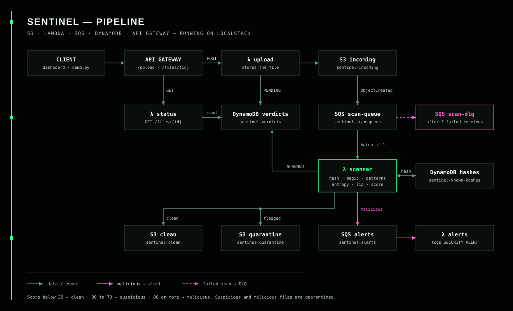

# Sentinel

> Every upload is guilty until proven clean.

A serverless file-scanning pipeline that runs **entirely on your laptop** using LocalStack.
Uploaded files are scanned, scored, and either released or quarantined. Nothing is shared until it passes.

Built for the *"Cloud in a Box" Local Serverless Hack (LocalStack)*.



## Architecture

```
POST /upload ─► API Gateway ─► Lambda: upload ─► DynamoDB (PENDING) + S3 [sentinel-incoming]
                                                        │ S3 event
                                                        ▼
                                              SQS: scan-queue ──(3 failures)──► SQS: scan-dlq
                                                        │
                                                        ▼
                                              Lambda: scanner
                                 ┌──────────────────────┼───────────────────────┐
                                 ▼                      ▼                       ▼
                         S3 [sentinel-clean]   S3 [sentinel-quarantine]   DynamoDB: verdicts
                                                        │ (malicious only)
                                                        ▼
                                              SQS: alerts ─► Lambda: alerts (logs SECURITY ALERT)

GET /files/{id} ─► API Gateway ─► Lambda: status ─► DynamoDB
```

AWS services used: **S3, Lambda, DynamoDB, API Gateway, SQS**.

## Prerequisites

Docker (with Compose v2), Terraform >= 1.5, Python 3.10+, make (optional), a LocalStack auth token.

## Quick start

macOS / Linux:

```bash
cp .env.example .env        # paste your LOCALSTACK_AUTH_TOKEN (optional for the community image)
make up                     # starts LocalStack and deploys everything with Terraform
make demo                   # uploads sample files and prints the verdict table
```

Windows (PowerShell) has a matching task runner:

```powershell
Copy-Item .env.example .env
.\make.ps1 up
.\make.ps1 demo
```

Prefer to run the steps by hand (any OS):

```bash
docker compose up -d --wait
cd terraform && terraform init && terraform apply -auto-approve && cd ..
python scripts/make_samples.py
python scripts/demo.py
```

## API

| Method | Path | Body / result |
|---|---|---|
| POST | `/upload` | `{"filename": "a.pdf", "content_b64": "<base64>"}` -> `202 {"file_id": "..."}` |
| GET | `/files/{id}` | `scan_state`, `verdict`, `risk_score`, `reasons`, `sha256`, `stored_at`, `cache_hit` |

Base URL: `cd terraform && terraform output -raw api_url`

## What the scanner checks

| Check | Catches | Points |
|---|---|---|
| Hash lookup (DynamoDB) | Known-bad files; also reuses earlier verdicts (idempotency) | reuses stored score |
| Magic bytes vs extension | `.exe` pretending to be `.pdf` | 70 / 25 |
| Filename tricks | `resume.pdf.exe`, dangerous extensions, RTL override | 40 / 20 / 40 |
| Content patterns | EICAR, PDF JavaScript/OpenAction/Launch, encoded PowerShell | up to 100 |
| Entropy | Packed or encrypted payloads | 20 |
| ZIP inspection (no extraction) | Zip bombs, VBA macros, encrypted or nested archives, embedded executables | 15 to 60 |

Score `>= 80` malicious, `>= 30` suspicious, otherwise clean. Suspicious and malicious files go to the quarantine bucket.
Every verdict includes the reasons that produced it.

## Reliability features

- **Queue buffering**: SQS absorbs upload spikes so the scanner works at a steady pace.
- **Retries + DLQ**: a failing scan is retried 3 times, then parked in `sentinel-scan-dlq` (try `crash-me.txt`).
- **Idempotency**: a file already scanned is skipped; identical content reuses the cached hash verdict.
- **Quarantine, not delete**: nothing is lost, which gives an audit trail.
- **Safe inspection**: archives are inspected from metadata only, never extracted.

## Tests

```bash
pip install -r requirements-dev.txt
make test
```

Sample files are generated by `scripts/make_samples.py` and are harmless. The EICAR file is the standard antivirus test
string; if your antivirus deletes it, that is expected.

## Troubleshooting

- **LocalStack unhealthy / license error**: check `LOCALSTACK_AUTH_TOKEN` in `.env`, or set `LOCALSTACK_IMAGE=localstack/localstack`.
- **Lambda cannot reach LocalStack**: make sure `/var/run/docker.sock` is mounted (see `docker-compose.yml`).
- **First run is slow**: Docker pulls images and the first Lambda invocation cold-starts.
- **`terraform apply` fails on provider download**: needs internet once to fetch the AWS and archive providers.
- **Reset everything**: `make down`.

## Project layout

See `docs/PLAN.md` for the full plan, milestones, and demo script.
